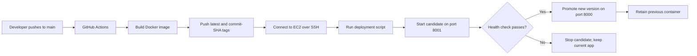

# FastAPI Cloud Deployment — Docker, GitHub Actions & AWS EC2

A small end-to-end CI/CD project that containerizes a FastAPI application, publishes versioned Docker images to Docker Hub, and deploys the selected image to an AWS EC2 instance through GitHub Actions.

## At a glance

| Area | Implementation |
|---|---|
| Application | Python + FastAPI |
| Containerization | Docker |
| Container registry | Docker Hub |
| CI/CD | GitHub Actions |
| Deployment target | AWS EC2 (Ubuntu) |
| Deployment access | SSH using GitHub Actions secrets |
| Health verification | FastAPI `/health` endpoint + Docker health checks |
| Image versioning | Git commit SHA, plus a `latest` tag |

## Architecture



## What happens on each deployment

1. A push to the `main` branch starts the GitHub Actions workflow.
2. The build job builds the Docker image and pushes two tags to Docker Hub: `latest` and the full Git commit SHA.
3. After the build job succeeds, the deploy job connects to the EC2 instance, copies `scripts/deploy.sh`, and runs it with the commit-SHA image tag.
4. The script starts a candidate container bound to `127.0.0.1:8001` and waits for its Docker health check to report `healthy`.
5. If the candidate passes, the script replaces the production container exposed on port `8000` and checks the application health endpoint.
6. The previous production container is retained as `fastapi-previous` to support recovery if the new deployment fails.

The deployment uses the commit-SHA tag rather than relying on the moving `latest` tag. This makes the deployed image traceable to the source commit that triggered the workflow. The workflow also uses a concurrency group to avoid overlapping production deployments.

## Application endpoint

| Method | Endpoint | Expected response |
|---|---|---|
| `GET` | `/health` | `{"status":"healthy"}` |

## Repository structure

```text
.
├── .github/
│   └── workflows/
│       └── docker-build.yml   # Build, push and deploy workflow
├── scripts/
│   └── deploy.sh              # EC2 deployment and recovery logic
├── main.py                    # FastAPI application
├── Dockerfile                 # Application image definition
└── README.md
```

## Required GitHub Actions secrets

Configure these secrets in **Repository → Settings → Secrets and variables → Actions**:

| Secret | Purpose |
|---|---|
| `DOCKERHUB_USERNAME` | Docker Hub account name |
| `DOCKERHUB_TOKEN` | Docker Hub access token used by the build job |
| `EC2_HOST` | Public IPv4 address or public DNS name of the EC2 instance |
| `EC2_SSH_KEY` | Private SSH key used by the workflow to connect to EC2 |

Do not commit credentials, private keys, or `.env` files to the repository.

## Run locally with Docker

Build the image:

```bash
docker build -t fastapi-cloud .
```

Start the container:

```bash
docker run --rm -p 8000:8000 fastapi-cloud
```

Test the health endpoint in another terminal:

```bash
curl http://localhost:8000/health
```

Expected response:

```json
{"status":"healthy"}
```

## Deploy through GitHub Actions

1. Create an Ubuntu EC2 instance and install Docker.
2. Configure the EC2 security group for the required SSH access and, when external testing is needed, application traffic on port `8000`. Restrict access to appropriate source ranges.
3. Add the four GitHub Actions secrets listed above.
4. Push a commit to the `main` branch.
5. Check the **Actions** tab to follow the build and deployment jobs.

After a successful deployment, verify the application from a machine that can reach the instance:

```bash
curl http://<EC2_PUBLIC_IP>:8000/health
```

On the EC2 instance, inspect the running application container:

```bash
sudo docker ps
```

## Engineering decisions demonstrated

- **Repeatable builds:** the application is packaged as a Docker image.
- **Traceable releases:** each build is tagged with its source commit SHA.
- **Separated pipeline stages:** deployment runs only after the image build-and-push job succeeds.
- **Secret handling:** registry credentials and SSH access material are stored as GitHub Actions secrets.
- **Deployment validation:** a candidate container is health-checked before it replaces the current application.
- **Deployment coordination:** GitHub Actions concurrency prevents simultaneous workflow deployments to the same target.
- **Recovery consideration:** the previous container is retained, and the deployment script contains a rollback routine for promotion failures.

## Scope and known limitations

- The application is exposed directly on port `8000`; this project does not currently configure a domain name, HTTPS certificate, or reverse proxy.
- The production container is replaced during deployment, so a short interruption may occur. This is **not** a zero-downtime blue-green deployment.
- The rollback routine is present and the previous container is retained, but a deliberate production-failure/rollback test has not yet been completed.
- This is a learning and portfolio project, not a hardened production architecture. Further work could include HTTPS, tighter network controls, deployment observability, and automated rollback testing.

## Cost reminder

AWS resources can incur charges depending on instance type, storage, public IPv4 usage, and account eligibility. Stop or terminate resources when they are no longer needed, and review associated storage and networking resources as well.
